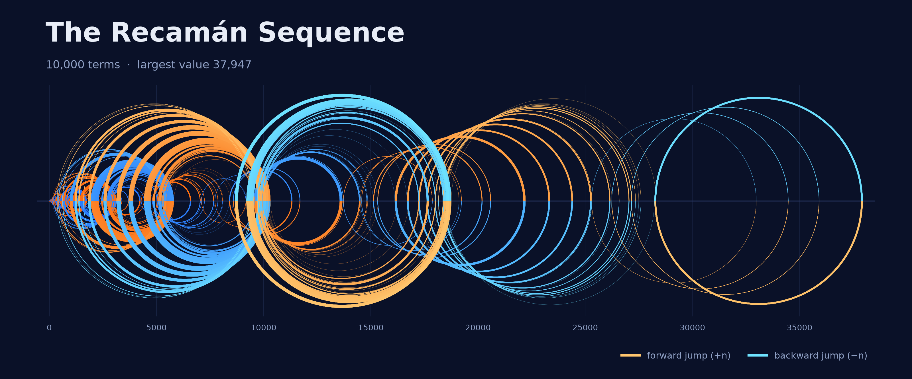

# Recamán Sequence

A small Python script that draws the [Recamán sequence](https://oeis.org/A005132) as an arc diagram, plus a place to run experiments on it.



## The rules

Start at zero:

$$a(0) = 0$$

For every step $n = 1, 2, 3, \dots$ try to jump **backwards** by $n$. If that is not allowed, jump **forwards**:

$$
a(n) =
\begin{cases}
a(n-1) - n & \text{if } a(n-1) - n > 0 \text{ and } a(n-1) - n \notin \{a(0), \dots, a(n-1)\} \\[4pt]
a(n-1) + n & \text{otherwise}
\end{cases}
$$

In words: go back by $n$ if you land on a positive number you have **never visited**; otherwise go forward by $n$.

The first terms: `0, 1, 3, 6, 2, 7, 13, 20, 12, 21, 11, 22, …`

Going forward may land on a number already visited (42 appears at both $n = 20$ and $n = 24$).

## Run it

```bash
pip install -r requirements.txt
python recaman.py                      # 10,000 terms -> output/recaman-10000.png
python recaman.py -n 5000 -o my.png    # custom number of terms and file name
```

| Option | Meaning | Default |
| --- | --- | --- |
| `-n`, `--terms` | number of terms | `10000` |
| `-o`, `--output` | output PNG path | `output/recaman-<n>.png` |
| `--dpi` | resolution (200 = 3200 px wide) | `200` |

## How to read the picture

Each step is a semicircle between two consecutive values on a number line. Arcs alternate above and below the line. **Orange** = forward jump (+n), **blue** = backward jump (−n), shading from dark (early) to light (late).

## Experiments

Everything beyond the picture lives in [`experiments/`](experiments/README.md): one folder per experiment, plus a running log of findings.

| # | Experiment | Status |
| --- | --- | --- |
| 01 | [Custom start value](experiments/01-custom-start/README.md) | planned |
| 02 | [Speed benchmark (1M / 1B iterations)](experiments/02-speed-benchmark/README.md) | planned |

See the [experiments index](experiments/README.md) for the full list, the findings log and how to add a new one.

## Notes

- The picture shows a finite prefix of an infinite sequence; it proves nothing about later terms.
- Open question: does every positive integer eventually appear? The smallest number not yet found is **852655**, still missing after $10^{230}$ terms ([OEIS A005132](https://oeis.org/A005132)).
